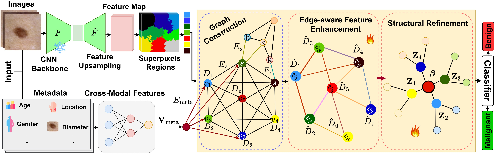

# Geometry-Aware Superpixel Graph Transformer with Metadata for Skin Lesion Classification

<p align="left">
  <a href="#" target="_blank" rel="noopener noreferrer"></a>
  <a href="https://doi.org/10.1007/978-3-032-38091-3_31" target="_blank" rel="noopener noreferrer"></a>
  <a href="https://github.com/azeemchaudharyg/GeoMeta-GT/blob/main/train.py" target="_blank" rel="noopener noreferrer"></a>
  <a href="#" target="_blank" rel="noopener noreferrer"></a>
</p>

Official repository accompanying the paper: **"Geometry-Aware Superpixel Graph Transformer with Metadata for Skin Lesion Classification"** 

**Authors:** Muhammad Azeem, Tanveer Hussain, Amr Ahmed, and Ardhendu Behera  

**Institution:** Edge Hill University, Ormskirk, Lancashire, UK

---

## Abstract
Automated skin cancer classification from dermoscopic images remains challenging due to heterogeneous lesion structure, strong intra-class variability, and subtle visual differences between benign and malignant cases. Existing CNN/ViT pipelines typically rely on global or patch-level features and often combine patient metadata via late fusion, which limits spatially grounded multimodal reasoning. We present a novel region-based graph learning framework that explicitly models lesions as graphs of spatially coherent superpixel regions represented as frozen CNN features. To capture fine-grained lesion arrangements, we encode inter-regional geometry as edge attributes and introduce a dedicated metadata context node connected to all regions, providing structured integration of demographic/clinical variables within the same relational space. Node representations are updated using our edge-aware graph transformer followed by attention-driven propagation, and a final graph-level embedding for benign–malignant classification. Experiments on four public benchmarks demonstrate that explicit region-level relational modeling and graph-native multimodal fusion yield consistent gains over the state-of-the-art. Consequently, we establish a new graph-centric perspective in which CNN features are modeled as relational nodes and improved through contextual integration, yielding more expressive and robust classifications.

---


## Key Contributions

* **Parameter-Efficient Classification Framework:** A spatially grounded and multimodally structured framework for robust dermoscopic skin lesion classification using a frozen backbone.

* **Geometry-Attributed Superpixel Graph Representation:** A region-level graph representation that captures spatial relationships between superpixels and integrates clinical metadata through a dedicated metadata node.

* **Edge-Aware Graph Transformer:** A graph transformer that leverages geometric edge attributes to facilitate spatially informed message passing and diagnostically relevant region aggregation.

* **Similarity-Weighted Region Refinement:** A refinement module that enhances feature consistency across semantically similar regions, improving the quality of graph representations.

* **Comprehensive Multi-Benchmark Evaluation:** Consistent performance improvements across multiple public skin lesion classification benchmarks, demonstrating the effectiveness of the proposed framework while retaining a frozen feature extraction backbone.

---

## Method Overview

The proposed **GeoMeta-GT** framework consists of the following stages:

1. **Frozen CNN Feature Extraction:** Extract spatially structured deep feature maps from dermoscopic images using a pretrained ResNet152 backbone, which remains frozen during training to reduce computational overhead and the number of trainable parameters.

2. **Deep Feature-Space Superpixel Decomposition:** Apply Simple Linear Iterative Clustering (SLIC) to the upsampled deep feature maps to partition each image into spatially coherent regions. This feature-space segmentation aims to capture semantically meaningful lesion structures.

3. **Region-Level Feature Representation:** Represent each superpixel as a graph node by concatenating mean-pooled and max-pooled deep features, combining global regional context with salient local information.

4. **Geometry-Aware Graph Construction:** Connect superpixel nodes using nearest-neighbour relationships based on their spatial coordinates. Encode inter-region Euclidean distance and relative orientation as edge attributes to preserve the geometric structure of the lesion.

5. **Metadata-as-Node Fusion:** Encode clinical metadata, including demographic and anatomical information, into a dedicated metadata node. Connect this node bidirectionally to all superpixel nodes, enabling joint visual and clinical reasoning through graph message passing rather than conventional late fusion.

6. **Edge-Aware Graph Transformer:** Integrate geometric edge attributes directly into the attention mechanism and message aggregation process, allowing the model to adaptively weight neighbouring regions according to their visual representations and spatial relationships.

7. **Similarity-Weighted Structural Refinement:** Refine the updated node embeddings through similarity-weighted propagation, encouraging semantically consistent regions to exchange information while suppressing inconsistent or noisy representations.

8. **Graph-Level Representation and Classification:** Apply global mean pooling to aggregate the refined node embeddings into a graph-level representation, followed by a trainable classifier to predict benign or malignant lesions.

<p align="center">
  <br>
  <em>Figure: GeoMeta-GT combines frozen deep visual representations, geometry-aware region-level graph reasoning, and graph-native clinical metadata integration within a parameter-efficient classification framework.</em>
</p>

---

## Installation & Setup

This framework leverages **PyTorch** and **PyTorch Geometric (PyG)** to run optimized graph message-passing operations.

### 1. Environment Initialization
```bash
conda create -n geom-gnn python=3.10 -y
conda activate geom-gnn
```
```
pip install requirements.txt
```

---

## Datasets

* **Multi-Benchmark Evaluation:** The proposed framework is evaluated on four public skin lesion datasets: ISIC 2024, HAM10000, PAD-UFES-20, and HIBA, covering diverse imaging conditions and variations in dataset characteristics.

* **Class Distribution and Imbalance:** The selected benchmarks exhibit different class distributions and levels of class imbalance, enabling evaluation of the framework's robustness in distinguishing benign and malignant lesions across diverse classification settings.

* **Clinical Metadata Integration:** In addition to dermoscopic image features, the framework incorporates available clinical metadata, including patient demographics and anatomical information, through a dedicated metadata node within the graph representation.

* **Multimodal Classification:** The datasets support the evaluation of joint visual and clinical feature learning, allowing the framework to investigate how metadata integration and geometry-aware graph reasoning contribute to skin lesion classification performance.

---

## Performance Comparison with State-of-the-Art (SOTA) Methods

The table below presents a comprehensive comparison of **GeoMeta-GT** against existing state-of-the-art methods across four public skin lesion classification benchmarks: ISIC 2024, HAM10000, PAD-UFES-20, and HIBA. Performance is evaluated using accuracy, precision, recall, and F1-score (%). The best-performing results are highlighted in **bold**.

| Dataset | Method | Accuracy (%) | Precision (%) | Recall (%) | F1-Score (%) |
|:---|:---|---:|---:|---:|---:|
| **ISIC 2024** | DSCC-Net | 94.17 | 94.17 | 93.76 | 93.93 |
| | HybridCNN | 94.44 | 94.38 | 94.21 | 94.44 |
| | Multimodal Contrastive | 96.69 | 96.14 | 96.41 | 96.69 |
| | **GeoMeta-GT (Ours)** | **98.61** | **98.58** | **98.64** | **98.61** |
| **HAM10000** | Transformer Network | 94.31 | 94.10 | 95.01 | 93.20 |
| | Inception-ResNet | 95.09 | 95.49 | 95.16 | 95.27 |
| | Hybrid LSTM-CNN | 96.21 | 94.75 | 94.93 | 95.55 |
| | **GeoMeta-GT (Ours)** | **98.23** | **98.21** | **98.26** | **98.23** |
| **PAD-UFES-20** | Multimodal Contrastive | 93.51 | 93.41 | 93.21 | 93.25 |
| | Context-Aware GNN | 94.29 | 94.40 | 94.29 | 94.26 |
| | Multimodal Learning | 95.61 | 95.54 | 95.12 | 95.61 |
| | **GeoMeta-GT (Ours)** | **97.17** | **97.17** | **97.21** | **97.17** |
| **HIBA** | MultiExCam | 85.11 | 86.20 | 84.45 | 85.11 |
| | Multimodal Contrastive | 87.51 | 86.40 | 87.51 | 88.51 |
| | Context-Aware GNN | 89.19 | 90.01 | 89.19 | 89.19 |
| | **GeoMeta-GT (Ours)** | **95.41** | **95.38** | **95.44** | **95.41** |

---

## Acknowledgments
This work was supported by UK Research and Innovation (UKRI) — Economic and Social Research Council (ESRC) grant SCAnDi (ES/Y010655/1), and the EU Marie Skłodowska-Curie Actions (MSCA) grant SynAM (HORIZON-MSCA-2022-SE-01, Project: 101129996).

---

## Citation
If you find our research useful in your work, please cite our paper:

```bibtex
@inproceedings{azeem2026geometry,
  title={Geometry-Aware Superpixel Graph Transformer with Metadata for Skin Lesion Classification},
  author={Azeem, Muhammad and Hussain, Tanveer and Ahmed, Amr and Behera, Ardhendu},
  booktitle={International Conference on Medical Image Computing and Computer-Assisted Intervention},
  pages={316--326},
  year={2026},
  organization={Springer}
  doi={10.1007/978-3-032-38091-3_31}
}


@InProceedings{10.1007/978-3-032-38091-3_31,
author="Azeem, Muhammad and Hussain, Tanveer and Ahmed, Amr and Behera, Ardhendu",
title="Geometry-Aware Superpixel Graph Transformer with Metadata for Skin Lesion Classification",
booktitle="Medical Image Computing and Computer Assisted Intervention -- MICCAI 2026",
year="2027",
publisher="Springer Nature Switzerland",
address="Cham",
pages="316--326",
isbn="978-3-032-38091-3"
}


